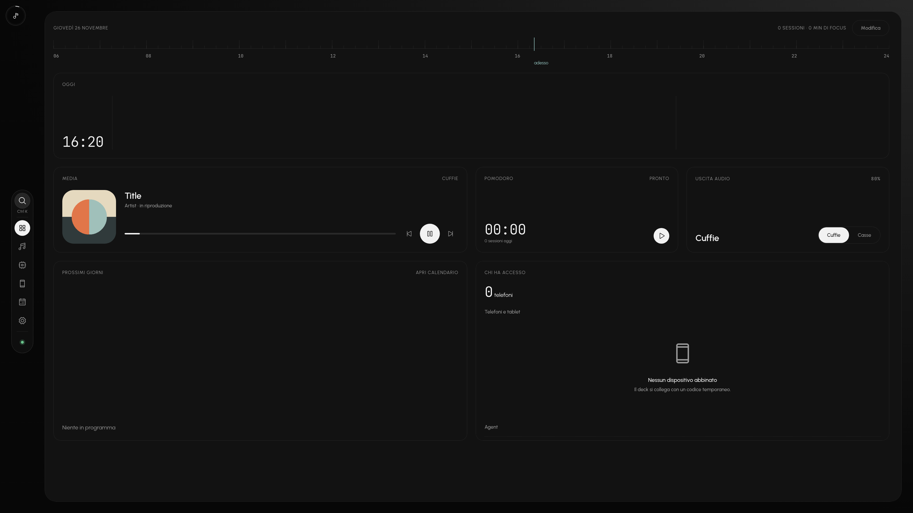
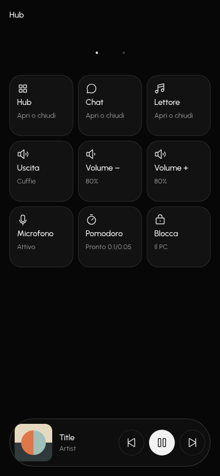

# Hub

A desktop control center with two views: a dashboard for the PC and a Stream Deck style panel for an old iPhone. Keep everyday controls, notes, timers and the day's events in one place, with actions shared across both screens.

Hub grew out of a collection of small tools I had built with AI agents for things like job searching, study, music, budgeting and AirPlay. They were scattered across my system, often hard to find or start without an agent, and sometimes duplicated the same context or functionality. I built Hub to bring them together in one place, where modules can share what they need and benefit from each other. It reflects how I use my desktop: a personal project shared as a showcase, not a general-purpose solution.

My main uses today are study and job searching. Studio replaces parts of a workflow I previously handled with NotebookLM and separate tools: an agent prepares a study plan tailored to my needs using a documented format, and Hub brings its activities, materials, timer and progress together for each session. Recorded progress feeds back into later plan revisions. Lavoro brings job searches, ranking, applications and interviews into the same workspace.

Built for Linux, Hyprland and Caelestia. The interface is in Italian.





Both screenshots use the isolated fake server, with generic fixtures and no personal modules.

## Try the demo

Requires Node 24 or later and pnpm 11 (the exact version is pinned in `package.json`).

```sh
pnpm install
pnpm demo
```

Open the printed `/desk` or `/deck` URL. The demo binds to loopback, simulates desktop commands and uses temporary databases, configuration and empty module roots. Ctrl+C stops both processes and deletes the temporary data. It does not load your local configuration or installed modules.

## How it fits together

Modules can connect to each other: the job search module uses email to link recruiter messages to applications, while work and study events can appear in the same calendar.

One Fastify server exposes a registry of actions with zod-validated inputs. The React desk and deck clients share its tRPC API and live updates. Side effects run through registered actions; the server does not accept arbitrary shell commands. Local data stays in SQLite databases.

I accepted more complexity in the initial foundation to make later additions simpler: modules reuse the registry, storage, UI and agent access rather than building those pieces separately.

```text
Desk dashboard ──┐
                 ├── tRPC / WebSocket ── Fastify ── action registry ── desktop tools
Phone deck ──────┘                         └── SQLite + modules
```

There are three module tiers:

- **Built-in core:** health, layout, devices, pairing, theme, notes, calendar, pomodoro, audio, media and system controls, plus the Oggi view.
- **Optional Git catalogs:** register a trusted source in Settings and install the modules you want. Modules can declare capabilities they provide or need from each other.
- **Private local modules:** keep personal integrations in the gitignored `modules.local/`; they take precedence over installed modules with the same name. <!-- guard-private: allow Repository-local module directory -->

The core works without a catalog or private repository. There is no default catalog URL. See [Writing a module](docs/modules.md) for discovery, storage, capabilities and tests.

The optional [Hub Shared Modules](https://github.com/imalbi/hub-shared) catalog contains Lavoro, Mail, Sites, Weather, Studio and Music. Studio's [plan writing guide](https://github.com/imalbi/hub-shared/blob/main/study/README.md) explains how agents create and revise plans while preserving progress. These modules are separate from the core demo shown above.

## Run on your desktop

Copy `config.example.json` to the gitignored `config.local.json` and adapt it to your own desktop. Real audio and media controls need PipeWire/WirePlumber (`wpctl`) and `playerctl`; other desktop actions depend on the tools documented in their modules. Windows support has not been verified.

```sh
pnpm dev          # API on 127.0.0.1:4180, Vite proxies /trpc
pnpm check        # privacy guard, types, module checks, lint, format and unit tests
pnpm verify       # check, fake-server e2e and production web build
pnpm smoke        # read-only check of installed desktop tools
pnpm serve        # build and serve the web app with the API
```

`pnpm typecheck`, `pnpm test`, `pnpm test:e2e` and `pnpm format` are also available. The private-data guard scans tracked content and commit messages; it does not inspect image pixels or guarantee that all private data is detected. See [onboarding](docs/onboarding.md), [module development](docs/modules.md) and [MCP setup](docs/mcp.md).

## Trust and security

Loopback clients have full desktop trust. Keep the default loopback binding and never put a local reverse proxy in front of Hub: it can make remote requests appear local. LAN access requires paired device tokens, but uses plain HTTP; pairing does not encrypt traffic. Use only a trusted network and do not expose Hub to the internet.

Catalog modules execute in the server process with its permissions. Install only code you trust; `--ignore-scripts` disables dependency lifecycle scripts, not module execution. See [SECURITY.md](SECURITY.md) for reporting vulnerabilities and the supported security boundaries.

## Desktop integration

Preview the files and diffs without writing configuration or starting services:

```sh
pnpm desktop:install
```

Run `pnpm desktop:install --apply` yourself to install. It builds the web app, backs up existing files, adds the Lua block to Caelestia's `hypr-user.lua`, merges its toggle into `cli.json`, and enables/starts the systemd user service. Reload Hyprland, then press Super+H to show or hide the desk. Hub starts with the next Hyprland session too.

The service uses the resolved Node binary, including with fnm, and existing configuration/database defaults. A successful `pnpm verify` refreshes the served UI; reload the page to see it. Restart a running backend with `systemctl --user restart hub.service` after server changes. Re-run the apply command only when desktop integration changes.

`pnpm desktop:install --uninstall` previews removal; add `--apply` to remove Hub's integration. Unchanged files regain their original text, unrelated later edits are retained, and backups stay alongside the files. Uninstall leaves the repository, database and personal configuration in place.

## Rights and third-party notices

Copyright 2026 Alberto Cerqua. All rights reserved. Hub's own source has no open-source license (`UNLICENSED` in `package.json`). No permission to reuse or redistribute it is granted beyond applicable law and GitHub's terms, which allow viewing and forking public repositories on GitHub. See [GitHub's licensing guidance](https://docs.github.com/en/repositories/managing-your-repositorys-settings-and-features/customizing-your-repository/licensing-a-repository).

Third-party components retain their own licenses: [Hairline UI, MIT](apps/web/src/components/ui/LICENSE), [Rough.js, MIT](apps/web/third-party/roughjs-LICENSE), [Urbanist, SIL OFL 1.1](apps/web/third-party/urbanist-OFL.txt) and [JetBrains Mono, SIL OFL 1.1](apps/web/third-party/jetbrains-mono-OFL.txt). Other dependencies carry their notices in their packages. These terms do not grant a license to Hub's own source.
